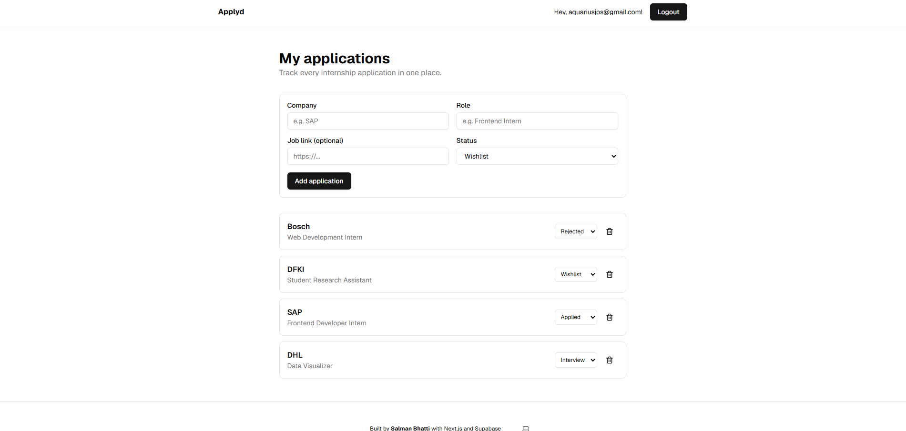
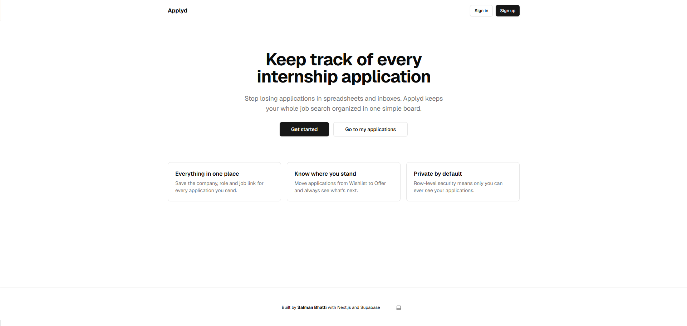

# Applyd: Internship Application Tracker

A full-stack web app to keep track of internship and job applications, built with Next.js and Supabase.

**Live demo:** https://application-tracker-nine-vert.vercel.app



## Why I built it

As a Media Informatics student looking for a mandatory internship, I needed one place to keep track of every application I send. Spreadsheets got messy, so I built my own tool and use it for my own job search.

## Features

- Sign up and log in with email (Supabase Auth)
- Add applications with company, role, job link and status
- Change status (Wishlist → Applied → Interview → Offer / Rejected) or delete applications
- Each user sees only their own data, enforced in the database with Row Level Security
- Clear empty, loading and error states
- Responsive layout with light and dark mode

## Tech stack

| Area | Technology |
|---|---|
| Framework | Next.js (App Router, Server Components, Server Actions) |
| Language | TypeScript |
| Styling | Tailwind CSS, shadcn/ui components |
| Database & Auth | Supabase (PostgreSQL, Row Level Security) |
| Hosting | Vercel |

## Design and technical decisions

- **Security in the database, not just the UI.** A Row Level Security policy (`auth.uid() = user_id`) makes sure users can only read and change their own rows, even if someone calls the API directly with the public key.
- **Server Components for data loading.** The dashboard loads data on the server, so no database logic runs in the browser.
- **Server Actions for changes.** Create, update and delete run on the server and refresh the page data with `revalidatePath`.
- **Validation on the server.** Status values are checked on the server and by a database constraint, never trusted from the browser alone.
- **Accessible controls.** The status dropdown and delete button work with keyboard and screen readers (`aria-label`, confirmation before deleting).



## Run it locally

1. Clone the repository and install dependencies:
```bash
   git clone https://github.com/msalmanbhatti/application-tracker.git
   cd application-tracker
   npm install
```
2. Create a free project on [Supabase](https://supabase.com) and run the SQL in [`supabase/schema.sql`](supabase/schema.sql) in the SQL Editor.
3. Copy `.env.example` to `.env.local` and add your Supabase project URL and publishable key.
4. Start the development server:
```bash
   npm run dev
```
5. Open http://localhost:3000.

## Roadmap

- [ ] Kanban board with drag and drop
- [ ] Search and filter
- [ ] Statistics (applications per week, response rate)
- [ ] AI-assisted matching of my CV against job descriptions

## Author

**Muhammad Salman Bhatti**, M.Sc. Media Informatics student at Saarland University
[GitHub](https://github.com/msalmanbhatti)